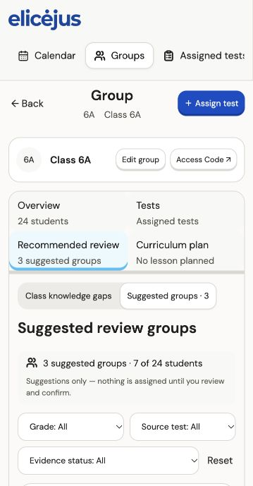

# High-fidelity v3 implementation · 14 Nov 2026

## Source and implementation

Baseline: [High-fid v1 & Prototyping](https://www.figma.com/design/evA3w2TOuO6N1AXL5Oldnv/INFO5900-Internal-Design-Files?node-id=1699-14238), page `1351:33703`, section `1699:14238`, “BBright baseline v3 · Client feedback”. The complete user-provided `.fig` export was decoded locally after the MCP View quota blocked retrieval. Component overrides and text properties were resolved before implementation. The 107-frame inventory includes overlays, responsive references and handoff frames; it is an inventory, not 107 independently verified pages. Raw design archives and decoded documents are not committed.

The app entry point now uses `HighFiApp.tsx`; `hi-model.mjs` contains the pure state rules. Shared navigation, buttons, native dialogs and existing local SVG/font assets are reused. Earlier mid-fidelity modules and documentation remain historical references, not the active app.

| Journey | Representative source nodes | Implemented behavior |
|---|---|---|
| Discover and evidence | 1699:14239, 1699:14352, 1699:15377, 1699:15497 | Suggested groups, filters, recipient editing, individual evidence and explicit uncertainty |
| Assemble and library | 1699:14472, 1699:14809, 1699:14831, 1699:16567 | Preview, add/replace/remove, staged review/reorder/apply, totals, simulated unavailable/stale/error states |
| Five-step review | v3 section 1699:14238 | Assemble → Differentiate → Review draft → Choose action → Confirm; support edits remain draft data |
| Schedule and conflict | 1699:17719, 1699:17789, 1699:17834 | Whole-class plan, conflict consent, final review, schedule validation |
| Success and calendar | 1699:17961, 1699:18001 | Linked lesson/station, planned-test shift, original 30-second Undo window |
| Assigned progress and follow-up | 1699:14673, 1699:14853, 1699:14872, 1699:14892, 1699:17668 | Persisted local assignments, sample progress/evidence, Noah + Sofia follow-up draft |

## Acceptance rules

- Default review contains Lesson 5 min + Station 8 min + Practice 3 min = 16 min. Assign now sends only the practice material: 3 questions / 3 min. Teacher resources are not sent to students.
- Add to class plan uses Lesson and Station, for all 24 students, without creating a student assignment. Practice stays in the draft. The chosen slot starts at 10:15; Lesson ends 10:20 and Station ends 10:28.
- Requested 21 Oct 09:20 conflicts with Protau. Accepting the proposed 22 Oct 10:15 slot previews the planned Fractions test moving from 22 Oct 09:00 to 26 Oct 09:00. The move happens only on final confirmation. Undo removes only that plan and restores the original planned-test date, preserving unrelated assignments.
- All final actions require teacher consent. Draft changes and restoration clear consent. Submission snapshots are independent of subsequent draft edits. Repeated submission of the same draft/action recovers the original record rather than duplicating it.
- Student support can be edited transactionally; unsupported mapping from support level to delivered exercises is labeled unverified. Evidence describes responses, not mastery. Sofia's single response never becomes a confident level recommendation.
- Local dates intentionally match the October example in the design. Drafts/records persist under new browser keys; older prototype storage is untouched.

## Verification

Completed on 14 Nov 2026:

- `pnpm test`: 23 passing tests, including 15 new high-fidelity domain checks. Coverage includes assignment/plan separation, totals, conflicts, atomic planned-test changes, Undo expiry and isolation, deduplicated retries, transactional material replacement, invalid dates/times, restoration and snapshot isolation.
- `pnpm build`: TypeScript check and Vite production build passed. `git diff --check` passed.
- Actual browser walkthrough: default review → Choose action → Assign now → confirmation consent gate → success → persisted Assigned tests. Verified that only 3 practice exercises were sent, despite 3 draft materials totaling 16 min.
- Second browser walkthrough: review → Add to class plan → schedule → conflict. Continue was blocked until the proposed resolution was accepted. Confirmed the 10:15–10:20 lesson and 10:20–10:28 station, then used Undo within the original window. Calendar showed linked items removed and the planned test restored. The independent assignment remained in Assigned tests.
- Opened student progress: Amelia completed, Noah in progress, Sofia not started; sample activity and evidence limitations were visible. Inspected narrow-screen overview and saved the screenshot below.
- Corrected nested render helpers that remounted form controls during the Undo timer tick, preserving input focus between renders.

## Remaining limits

This is an interactive frontend prototype with synthetic data and browser storage. No backend, authentication, real exercise engine, live student activity or real calendar write is connected. Failure controls simulate service responses; tests cannot establish production idempotency or durability.

The full guided review is the fractions journey supplied by the v3 walkthrough. Decimals has evidence/detail coverage and percentages explicitly lacks sufficient evidence; neither is claimed as a complete material-delivery flow. Library achievement-level selections are illustrative labels; the local fixture does not establish a real level-to-resource search index. Month and Day are reference-only and explain that Week is the available calendar view. External school/community destinations are not integrated.

The [15 Nov UI alignment pass](UI-ALIGNMENT.md) adds 45 captures and 194 passing source-derived container-anchor checks at desktop/reference widths, plus actual browser acceptance of recovery states. This is not a zero-pixel assertion for all 107 source frames. A full keyboard/screen-reader audit and independently runnable browser automation remain outstanding. Native dialogs support browser focus/Escape behavior, but that is not a completed accessibility audit. The course's final rubric and production API contracts have not been supplied. The PR remains a draft for team review rather than a claim of full production readiness.

## Data provenance

No external data service is connected. `hi-model.mjs` and the fixture objects in `HighFiApp.tsx` contain local synthetic data adapted from the Figma walkthrough (example names, response counts, materials and schedule). Additional progress, failure and recovery fixtures simulate behavior for demonstration; they are not analytics, live activity or model-generated diagnoses. User-created drafts and records are stored in localStorage on that browser only. Design-derived samples and implementation fixtures should not be interpreted as real student information.
