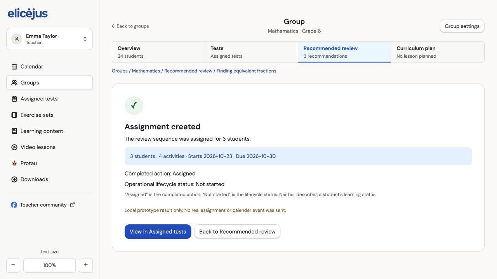

# UI acceptance · 15 Nov 2026

See [the full UI alignment audit](UI-ALIGNMENT.md): 45 captures, 194 passing source-derived container-anchor checks, both action branches and recovery, and all 23 domain tests passing. Verified the 1280×800 and 1024×800 references plus a 390×844 usability smoke check. Failure controls are hidden from the default client view; append `?testing=1` to use them.

# Detail badge alignment · 15 Nov 2026

Corrected the recommendation detail header against cached Figma D02 (`1699:14352`): Suggested group, Needs review and Repeated evidence now share the status row beneath the title. Browser DOM geometry at 1280×800 confirmed all three labels have the same y coordinate (338.39 px). At narrow widths the row wraps naturally. Screenshot: `screenshots/hi-v3-detail-badges.png`. All 23 domain tests and production build passed. This check covers this header, not all outstanding visual differences.

# Current verification · 14 Nov 2026

See [high-fidelity v3 acceptance and limits](HI-V3-IMPLEMENTATION.md#verification). The following records are historical.

# Current verification

See [29 Oct v4 implementation and test results](V4-IMPLEMENTATION.md#verification). The following is the historical first-prototype test record.

# Verification · 22 Oct 2026

## Completed checks

- `pnpm install` completed with esbuild explicitly allowed.
- `pnpm test`: 3 passing domain tests covering dynamic duration, invalid schedules and confirmation/recipient/material gates.
- `pnpm build`: TypeScript and production Vite build passed.
- Browser at 127.0.0.1:5173: opened recommendation overview, inspected layout against Figma reference, opened evidence, started review, selected the fourth material, saved draft, continued through support/review/action/settings/confirmation.
- Adding the fourth 1-minute item changed the total from 15 to 16 minutes and four activities; review and confirmation displayed the recalculated total.
- Confirm and assign was disabled before the teacher-review checkbox was checked.
- Enabled simulated submission failure, attempted submission, verified retained draft/error, disabled simulated failure, retried successfully.
- Success displayed 3 students, 4 activities, actual chosen dates, completed action Assigned, lifecycle Not started, and an explicit local-only notice. View in Assigned tests displayed the submitted snapshot.
- Local SVG logo/navigation assets visibly loaded. Asset paths are local, not expiring Figma URLs.

## Remaining verification

Full automated browser regression, narrow viewport visual QA, modal focus trapping, full assistive-technology audit, save/restore after refresh, both action branches with all invalid/empty combinations, complete asset geometry comparison across all design frames, live backend/calendar operations and GitHub Actions result. Domain tests are not a substitute for these checks. CI configuration is included; its remote result must be checked separately.

## 2026-11-16 — action-bar overlap and dialogs

The earlier responsive audit missed vertical overlap: absolutely positioned action bars covered student rows and material cards while scrolling. All direct panel action bars now follow content in normal flow (scroll to the end for actions); removed the footer-height observer. This intentionally changes the web positioning while preserving the design content.

All five application dialog types were exercised: information, students (Save), unsaved support (Continue without changes), resource preview (Close), follow-up evidence (Back to progress). Date/time controls now use the same top-layer modal instead of absolute popovers that could be clipped by the form rail or panel. Date and time selections both updated the form, and explicit confirmation successfully created the prototype assignment.

Checks in production Chromium preview: six footer states at six sizes (1440×900, 1280×600, 1024×768, 800×600, 390×844, 320×568) had no overlap with preceding content and no page horizontal overflow. Dialog measurements at five sizes found no viewport escape, horizontal body overflow or escaping controls. All five application modal types plus date/time were checked. See [raw results](screenshots/overlay-fix/checks.json), [materials](screenshots/overlay-fix/materials.png), [footer after content](screenshots/overlay-fix/materials-footer.png), and [mobile date picker](screenshots/overlay-fix/date-mobile.png).

`pnpm test`: 23 passing. `pnpm build`: TypeScript and Vite production build pass. This supersedes the previous measured-height/fixed-footer approach in RESPONSIVE-FIX.md.
