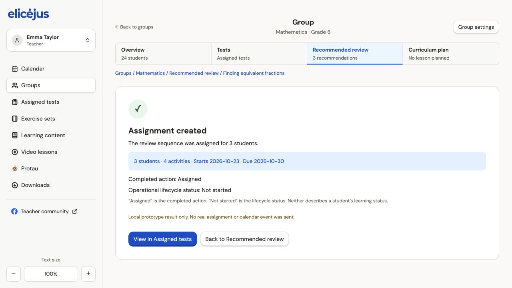

# Verification · 22 Oct 2026

## Completed checks

- `pnpm install` completed with esbuild explicitly allowed.
- `pnpm test`: 3 passing domain tests covering dynamic duration, invalid schedules and confirmation/recipient/material gates.
- `pnpm build`: TypeScript and production Vite build passed.
- Browser at 127.0.0.1:5173: opened recommendation overview, inspected layout against Figma reference, opened evidence, started review, selected the fourth material, saved draft, continued through support/review/action/settings/confirmation.
- Adding the fourth 1-minute item changed the total from 15 to 16 minutes and four activities; review and confirmation displayed the recalculated total.
- Confirm and assign was disabled before the teacher-review checkbox was checked.
- Enabled simulated submission failure, attempted submission, verified retained draft/error, disabled simulated failure, retried successfully.
- Success displayed 3 students, 4 activities, actual chosen dates, completed action Assigned, lifecycle Not started, and an explicit local-only notice. View in Assigned tests displayed the submitted snapshot.
- Local SVG logo/navigation assets visibly loaded. Asset paths are local, not expiring Figma URLs.

## Remaining verification

Full automated browser regression, narrow viewport visual QA, modal focus trapping, full assistive-technology audit, save/restore after refresh, both action branches with all invalid/empty combinations, complete asset geometry comparison across all design frames, live backend/calendar operations and GitHub Actions result. Domain tests are not a substitute for these checks. CI configuration is included; its remote result must be checked separately.
