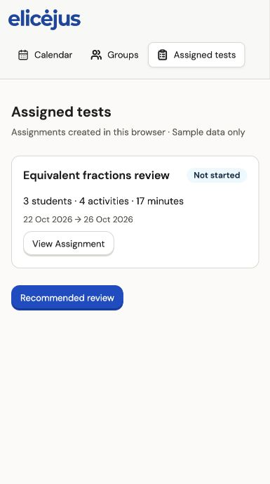

# Current implementation · 29 Oct 2026

Source: [mid-fid v4 / CURRENT BASELINE · Teacher Walkthru.2 · 27 Oct 2026](https://www.figma.com/design/evA3w2TOuO6N1AXL5Oldnv/INFO5900-Internal-Design-Files?node-id=767-18384). Repository: maxi-9150/MPS-Project-Workflow (renamed from info5900-figma-workflow).

## Run and use

```sh
pnpm install --frozen-lockfile
pnpm dev
pnpm test
pnpm build
```

Open the Vite URL. Recommended review → Finding equivalent fractions → View evidence / Start review → Prepare materials → Review & adapt → Assignment settings → Confirm assignment → View Assignment → Open Calendar.

Edit materials changes the selected sequence and calculated time. Edit recipients & support changes student participation/support without inventing achievement levels. Edit schedule controls delivery and planned date/time. Save draft persists to this browser. Confirmation is cleared by any draft edit and by draft restoration. Completed assignments also persist after refresh.

## Design changes implemented

- Four-step flow replaces the previous five-step-plus-settings flow. There is no separate Assign versus Plan fork.
- Default sequence is 5 + 8 + 3 = 16 minutes, matching the current D03 and D12 frames.
- Final confirmed Assignment mirrors only selected Lesson / Station material to local Curriculum plan / Calendar. Practice sets and exercises remain Assignment-only.
- Undo is available for 30 seconds and removes only that Assignment and its associated Calendar items. Existing Protau and Fractions test entries remain unchanged.
- Local submission simulates a short pending state, prevents double-click creation and reuses a draft ID for safe retries. No real network operation or backend idempotency is claimed.
- Persistent local assignment list, details, week navigation, source information, and Calendar event information are connected.
- Native dialog elements provide keyboard focus containment and Escape dismissal for material, support and schedule edits.

## Traceable design coverage

| Node | Frame | Status |
|---|---|---|
| 767:18385 | D01 Discover review need | Implemented, original local SVGs reused by matching source component |
| 767:18515 | D02 Recommendation and evidence | Implemented for supplied equivalent-fractions sample |
| 767:18700 | D03 Prepare material draft | Implemented |
| 767:19180 | D12 Review complete plan | Implemented |
| 767:19264 | D13 Assignment settings | Implemented |
| 767:19636 | D19 Assignment created | Implemented with local Undo |
| 767:19475 | P01 Assignment details | Implemented; progress destination explicitly unavailable |
| 767:20361 | C01 Calendar week of 19 Oct | Implemented and connected to local assignment items |
| 767:19731 | Confirmed decisions | Implemented Lesson/Station-only sync and 30-second Undo rule |
| 767:19354 | D16 Final confirmation | New source request returned quota error; retained/adapted prior confirmation behavior, not claimed as a visually verified v4 frame |

## Source-access blocker: not complete

Figma MCP returned a View-seat tool-call-limit error while reading D16. whoami confirms View seats on the Starter team and BBright Professional plan. No further high-fidelity requests were made after that error.

The following current frames are **not implemented from their current designs**: F4 D04–D09 search/provenance/selected sequence; D18 submitting and D18-F retry layout; P02 progress; P03 results; P04 response evidence; F00–F02 Freeform Assignment; C01b second-week layout; C02 Calendar event editor; E03 assignment/calendar edit. Their names were discovered in metadata, but metadata alone was not used to fabricate their layouts. Material search/support/schedule dialogs, assignment list and week switching are functional adaptations rather than claims of exact reproduction of these unread frames.

To complete these pages, restore Figma MCP access for the source file or supply the missing design exports/context. No paid seat changes or new charges were made.

## Verification

- TypeScript and production build pass.
- Eight domain tests pass: legacy guards plus v4 total, sync eligibility, invalid dates/times, consent, safe retry, Undo expiry/isolation, draft restore filtering and practice-only sync behavior.
- Browser: added a fourth material; all totals changed to four activities / 17 minutes while Calendar additions remained two items / 13 minutes.
- Browser: saved draft, moved through all four steps, confirmed unchecked consent disables submission; enabled simulated failure, observed retained draft, disabled failure and retried successfully.
- Browser: opened Assignment details and Calendar; only Lesson/Station items appeared alongside unchanged Protau/Fractions test entries.
- Browser: refreshed and opened Assigned tests; the Assignment remained available.
- Narrow viewport: checked readable material rows, bottom action controls, dialog and horizontal Calendar scrolling. Desktop source screenshots were read; a full same-viewport desktop pixel/asset-geometry audit is still pending because the browser viewport override and native capture did not agree.
- Static assets are local, and the same logo/sidebar source components are used. This change introduces no new Figma bitmap/vector assets. No runtime Figma asset URL is used.
- Undo expiry and retry duplication were tested at the domain level; complete browser regression for every empty/error case and assistive-technology audit remain pending.



## Limits

Sample students only. localStorage is device/browser-specific. No real authentication, student delivery, grading, server persistence, cross-device synchronization or external Calendar integration. Dates remain the design's sample dates. Calendar rows share the configured planned start; per-item sequencing and scheduling edits need confirmation from the unread Calendar details design. Existing data from the older prototype uses separate storage keys and is not migrated automatically.
